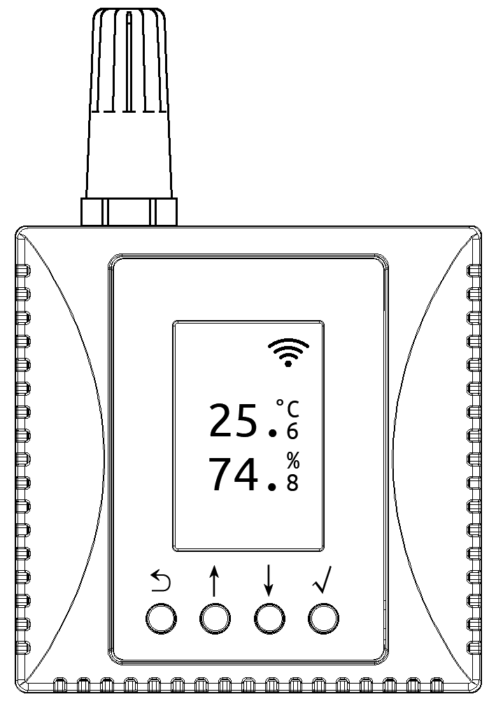
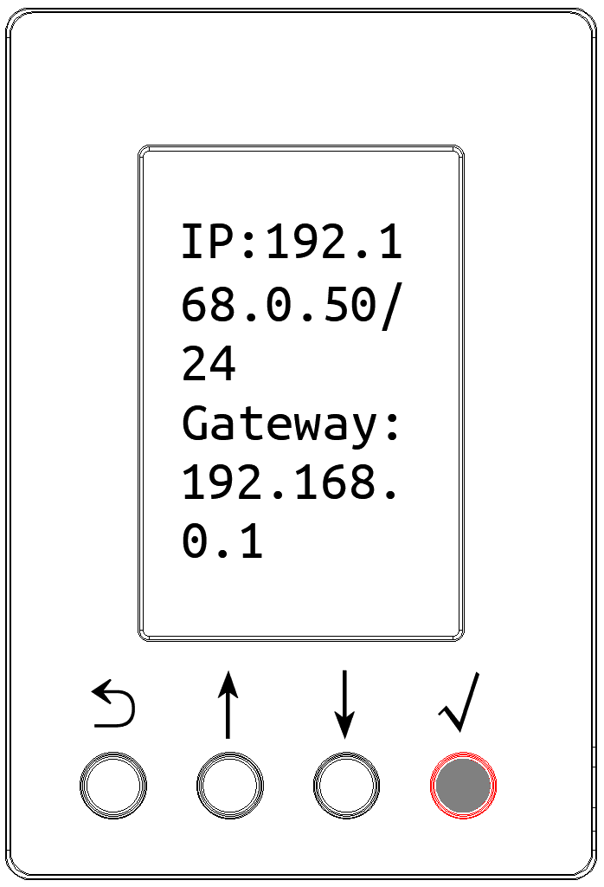
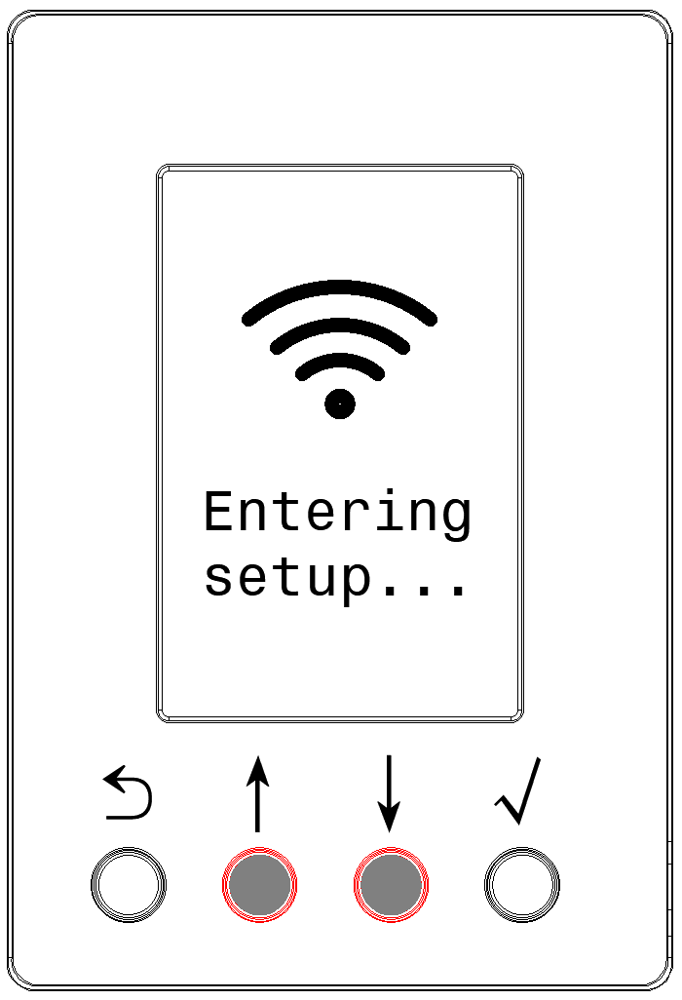
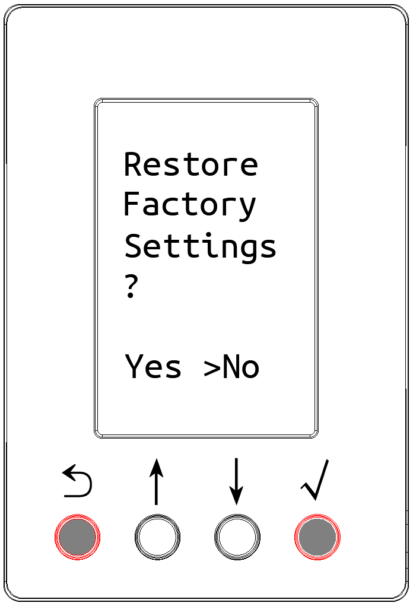
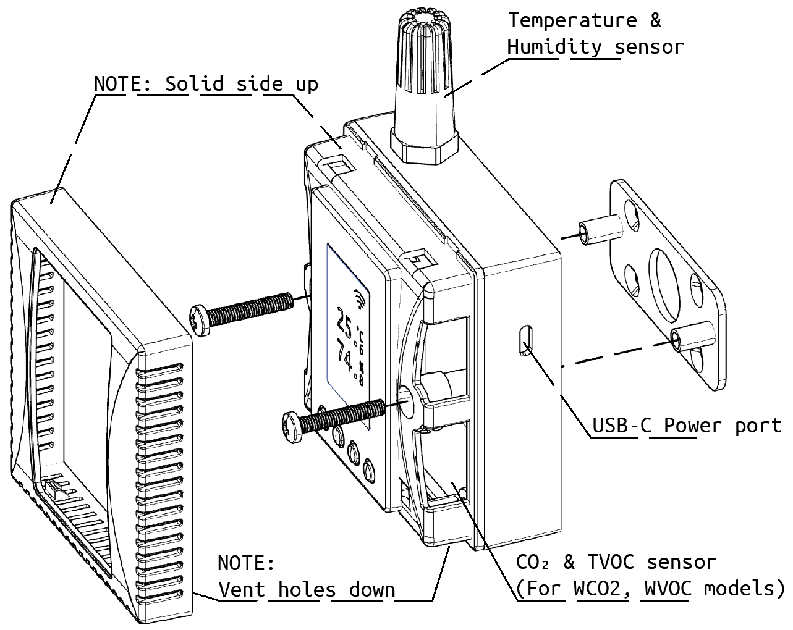

# Producttechnische Specificaties

## Meetbereik en Nauwkeurigheid

<ul>
<li>Temperatuurbereik: -25 ~ +65 ℃</li>
<li>Nauwkeurigheid: ±0,4°C (bereik 0~65°C), ±0,8°C (volledig bereik)</li>
</ul>

<ul>
<li>Bereik Relatieve Luchtvochtigheid: 0 ~ 100 %RV</li>
<li>Nauwkeurigheid: ±3,5% (bereik 10~90%), ±5% (volledig bereik)</li>
</ul>

## Stroomvoorziening

- Ondersteunt USB Type-C 5V-ingang. Nominale stroom: 100mA, Piekstroom: < 200mA.
- Ondersteunt voeding via interne DC-klem, nominale ingangsspanning DC12V, bereik DC9~28V.

## Draadloze WLAN-communicatie

Ondersteunt IEEE 802.11 b/g/n standaard 2,4 GHz band Wi-Fi-netwerken.

# Beschrijving van het Scherm en de Toetsen

- In de normale weergavemodus toont het LCD-scherm van het apparaat de temperatuur, de luchtvochtigheid en andere parameterwaarden.
- Houd de √-toets 1 seconde ingedrukt om de parameterinterface van het apparaat te openen, waar u het IP-adres, de tijd, het MAC-adres, het Wi-Fi-netwerk, de firmwareversie, enz. van het apparaat kunt bekijken.
- Houd de middelste ↓- en ↑-toetsen tegelijkertijd 5 seconden ingedrukt om de Wi-Fi-configuratie-interface te openen. Scan de QR-code op het scherm met een telefoon of tablet om het Wi-Fi-configuratieprogramma te openen.
- Houd de zijkant-toetsen ⟲ en √ tegelijkertijd 5 seconden ingedrukt om de fabrieksreset-interface te openen.

  

  

  

  

# Installatie-instructies

Het apparaat kan met de achterplaathouder en schroeven aan een muur of vlak oppervlak worden bevestigd.

Scan de QR-code om de gedetailleerde gebruikersinstructies te bekijken

